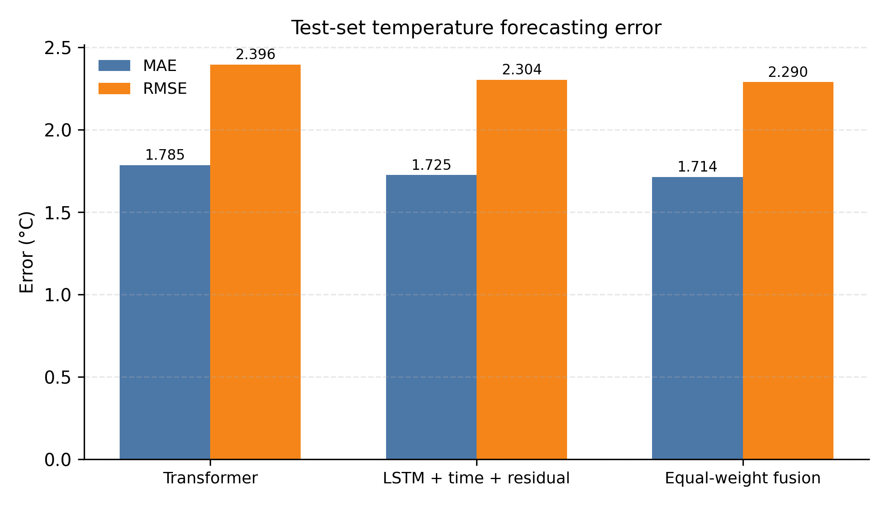
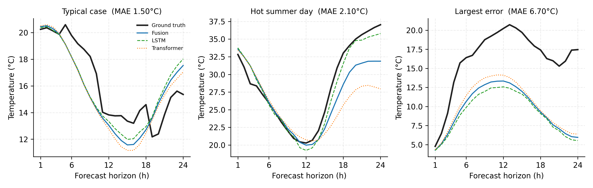
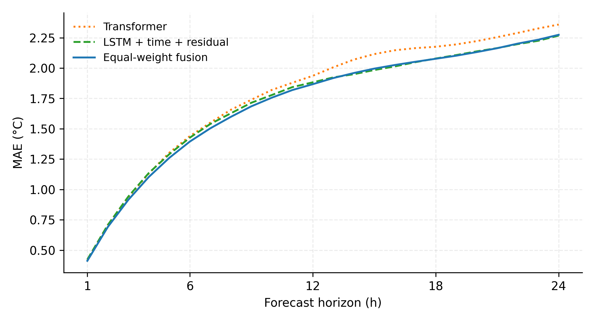

# LSTM–Transformer Fusion for Multivariate Weather Forecasting

A complete, reproducible pipeline for hourly temperature forecasting on the Jena
Climate dataset. The project trains an LSTM and a Transformer encoder on the same
72-hour input windows, then combines their 24-hour forecasts with a validation-set
learned weighting rule.

**Author:** Lei Pan · School of Artificial Intelligence, Jilin University



## Results

The test set is used once, after model and fusion selection on validation data.
Errors are in °C, computed on the original temperature scale.

| Model | Test MAE | Test RMSE | Validation MAE |
| --- | ---: | ---: | ---: |
| Transformer encoder (d128-L3) | 1.785 | 2.396 | 1.6615 |
| LSTM + time features + residual | 1.725 | 2.304 | 1.6612 |
| Equal-weight fusion (selected on validation) | **1.714** | **2.290** | **1.6312** |
| Learned scalar α / per-horizon αₜ | — | — | 1.6314 / 1.6314 |
| Robust bootstrap fusion | 1.722 | 2.300 | — |

The validation MAE selects equal-weight fusion over the learned scalar and
per-horizon variants. For reference, the learned scalar is **α = 0.540** for the
LSTM component. Validation and test splits contain 6,886 and 13,891 windows,
respectively.





## Problem Setting

- **Dataset:** Jena Climate, hourly observations from 2009–2016.
- **Input:** the past 72 hours of 7 meteorological variables.
- **Output:** the next 24 hourly temperatures (multi-step forecasting).
- **Split:** chronological 70% / 10% / 20% training / validation / test.
- **Preprocessing:** train-only standardization; `-9999` sentinel values are treated
  as missing wind observations; invalid or discontinuous windows are removed.
- **Metrics:** global MAE and RMSE in °C over all samples and horizons.

The LSTM uses two layers with time-of-day/year cyclical features and predicts a
residual relative to the last observed temperature. The Transformer is an
encoder-only model with three layers, four attention heads, and a pooled
24-step prediction head. Fusion weights are fitted on validation predictions only;
the test set is never used to choose the fusion rule.

## Repository Layout

```text
code/
  common/          data protocol, loaders, metrics for the Transformer/fusion pipeline
  transformer/     encoder-only Transformer and PatchTST baseline
  fusion/          validation-set weighting and final evaluation
  lstm_common/     data protocol, loaders, metrics for the LSTM pipeline
  lstm/            LSTM model, training, prediction export
data/
  README.md        dataset download instructions (raw CSV is not stored here)
docs/
  method.md        data protocol, models, fusion, and leakage controls
  reproducibility.md  environment and command-line reproduction
figures/           English result figures
outputs/
  checkpoints/     final LSTM checkpoint
  preds/           final LSTM validation/test predictions (npy)
  v3/checkpoints/  final Transformer checkpoint
  v3/preds/        final Transformer and ground-truth predictions (npy)
  v3/fusion/       fusion reports and fused predictions
  logs/            LSTM training summary
```

## Quick Start

```bash
python -m venv .venv
source .venv/bin/activate          # Windows: .venv\Scripts\activate
pip install -r requirements.txt
```

The raw CSV is not committed. Download the public Jena Climate archive and unpack
it into `data/jena_climate_2009_2016.csv` (see `data/README.md`), or run the data
loader once and let it download:

```bash
python code/common/data.py
```

Reproduce the final fusion from the included prediction files:

```bash
python code/fusion/fusion.py
```

Re-export predictions from the included checkpoints (data required):

```bash
python code/transformer/export_preds.py --model enc
python code/lstm/export_preds.py --tag lstm_time_res
```

Full retraining (GPU recommended):

```bash
python code/transformer/train_enc.py --final
python code/lstm/train.py --tag lstm_time_res --time-features --residual
```

The first command trains the Transformer; the second trains the selected LSTM
variant (`--time-features --residual`). Exact commands and environment notes are in
`docs/reproducibility.md`.

## Reproducibility Notes

- The data protocol and 70/10/20 chronological split are shared by both pipelines.
- Standardization statistics are fitted on the training segment only.
- Fusion parameters are estimated on validation predictions; the test set is used
  once for the final table.
- The included checkpoints and prediction arrays allow the fusion result to be
  reproduced without retraining.
- Raw data, per-epoch experiment caches, and training logs are kept out of version
  control to keep the repository small.

## Limitations

The study covers one station and one target variable. The LSTM and Transformer are
small models trained on a single GPU; longer horizons, other weather stations, and
probabilistic forecasts are left for future work. The test results are a single
chronological hold-out, not a rolling-origin evaluation.

## Citation

```bibtex
@misc{pan2026weather,
  author = {Pan, Lei},
  title  = {LSTM--Transformer Fusion for Multivariate Weather Forecasting},
  year   = {2026},
  url    = {https://github.com/LeiPan-JLU/lstm-transformer-weather-fusion}
}
```

## License

MIT License, Copyright (c) 2026 Lei Pan.

The Jena Climate dataset is publicly distributed by the Max Planck Institute for
Biogeochemistry and is not redistributed in this repository.
